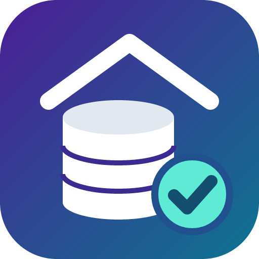

# BackupHaven

Simple, automated backups for the apps on your Unraid server.

Every night BackupHaven backs up your Docker containers' settings and data into
**one compressed file**, checks every database inside it for damage, keeps a
sensible history of backups, and makes restoring an app easy and reversible.

- **Nothing goes offline**: databases are copied while the apps run. Stopping a
  container during its backup is a per-app choice.
- **Damage is noticed the night it happens**: every SQLite database is checked,
  and the last good copy of each database is never deleted.
- **Plugins**: each app (Sonarr, Radarr, Plex...) and each place to store
  backups is a plugin, so support for more apps and providers can be added by
  anyone. Plugins run locked in, with permissions you approve.

> **Status: early releases (0.0.2.0).** Nightly backups, keep rules, database
> checks and the Dashboard, Backups, Apps and Settings pages work. Restore,
> alerts and stop mode come next ([roadmap](ARCHITECTURE.md#13-roadmap)).
> Restoring is by hand for now: each backup is a standard `.tar.zst` file.
>
> Install: see the [installing guide](docs/guide/install.md).
> Design: [ARCHITECTURE.md](ARCHITECTURE.md), [SECURITY.md](SECURITY.md),
> [docs/adr/](docs/adr/), [docs/plans/](docs/plans/).

## License

GPL-3.0. See [LICENSE](LICENSE).
